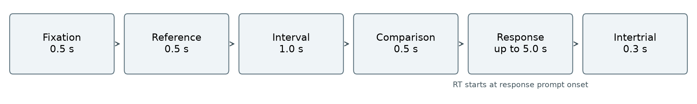
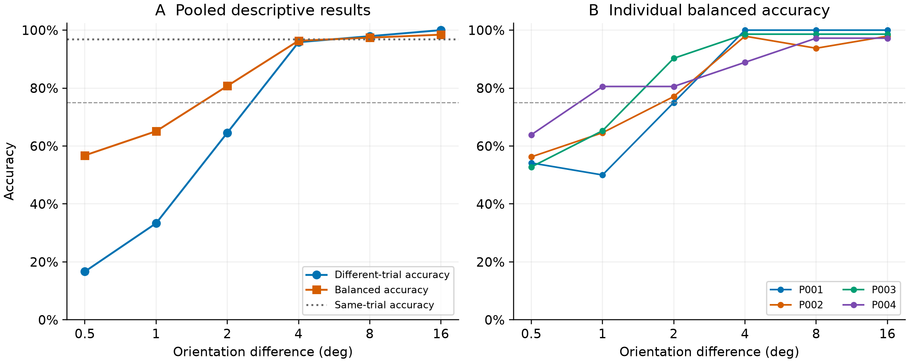
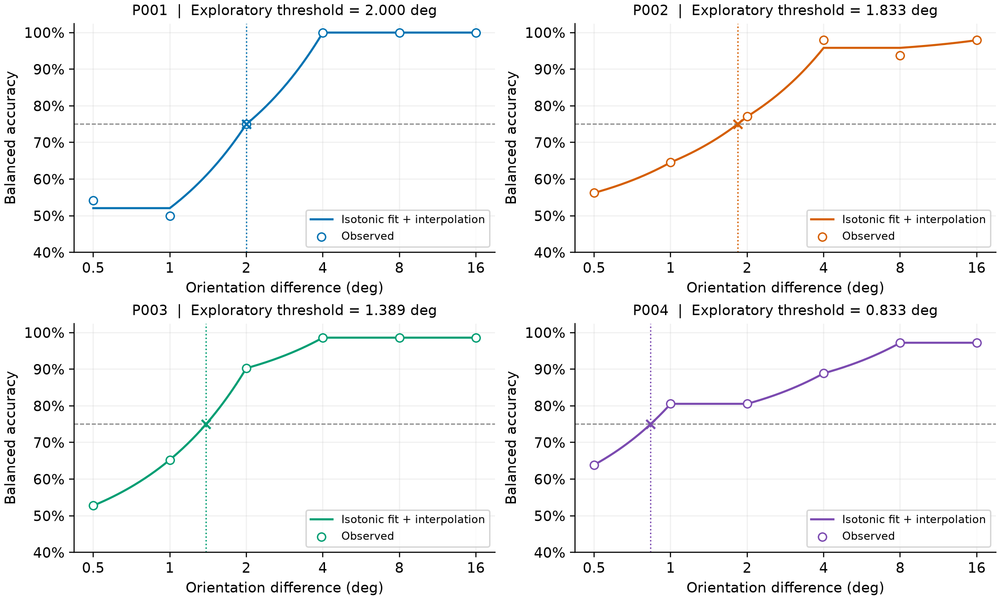
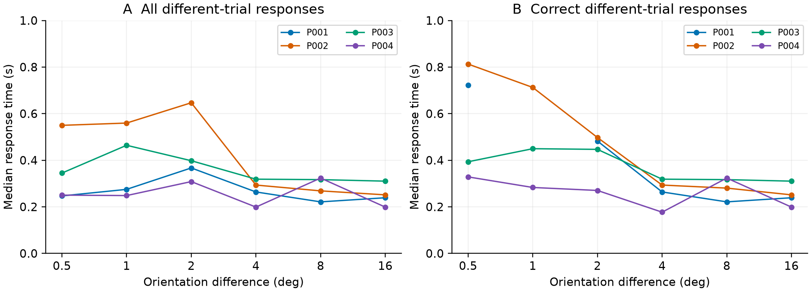

# 方位差感知能力测量：Gabor 光栅实验报告

## 摘要

本实验通过序列呈现两个 Gabor 光栅，测量 4 位参与者感知方位差异的能力，以不同方位差下的正确率和个体操作阈值作为量化指标。实验采用恒定刺激法，4 位裸眼或矫正视力正常的参与者各完成 144 个正式试次，其中相同与不同试次各占一半。非零方位差为 0.5°、1°、2°、4°、8°和 16°。576 个正式试次的总正确率为 82.47%，相同试次正确率为 96.88%，虚报率为 3.13%，无超时。不同试次正确率随方位差从 16.67% 上升至 100.00%，对应的平衡正确率从 56.77% 上升至 98.44%。以 75% 平衡正确率为操作准则，经单调回归和线性插值得到 P001、P002、P003 和 P004 的探索性阈值分别为 2.000°、1.833°、1.389°和 0.833°。这说明本次任务下各参与者的方位差辨别能力存在差异，达到该准则所需的方位差约为 0.8°至 2.0°；4°及以上时辨别表现较好。由于刺激未进行视角校准且判断可能受应答标准影响，结果用于描述本次参与者在该任务中的能力，不能据此确定群体 JND。

关键词：方位辨别；Gabor 光栅；恒定刺激法；相同／不同判断；平衡正确率

## 1 研究目的

本实验围绕“通过实验测量自己或朋友感知方位差异的能力”这一作业要求开展，具体测量 4 位参与者在多小的方位差下能够较可靠地判断两个刺激不同。实验使用带 Gaussian 遮罩的正弦光栅，在保持刺激尺寸、空间频率参数和对比度参数不变的条件下，改变比较刺激相对于参考刺激的方位，记录相同／不同判断。

主要测量结果是每位参与者在各档方位差下的正确率，以及达到 75% 平衡正确率的探索性操作阈值；该准则用于将“较可靠地辨别”转化为可计算的指标。相同刺激控制试次用于估计正确拒绝率和虚报率，从而同时考察差异检出与应答倾向。反应时作为补充描述。实验后采用单调回归统一处理各参与者曲线中的采样波动，再通过插值估计阈值。本实验着重描述实际参与者的能力，不以确定人群普遍阈限为目标。

## 2 方法

### 2.1 参与者与分析样本

4 位参与者使用 P001 至 P004 作为匿名编号。每人完成 1 次演示和 1 次正式实验。两次实验各包含 8 个练习试次；演示另含 24 个主试次，正式实验另含 144 个主试次。共完成 736 个试次，其中 64 个练习试次和 96 个演示主试次用于熟悉任务，不进入正式分析，最终纳入 576 个正式主试次。

参与者均具有正常裸眼或矫正视力，并以匿名编号记录。统计以参与者为个体分析单位。

### 2.2 实验装置与刺激

实验采用 PsychoPy 编写和运行，键盘后端为 ptb。显示设备为 16 英寸、16∶10 的笔记本屏幕。正式实验的实际窗口分辨率为 2560 × 1600 像素，采用全屏显示；各正式会话的软件测量刷新率为 164.646 至 165.339 Hz。各参与者在相同且良好的环境照明下完成实验。刺激绘制和键盘采集由 PsychoPy 完成[1]。

Gabor 光栅呈现在屏幕中央，参考方位为 0°。光栅尺寸为窗口高度的 0.3，按记录的窗口尺寸换算，其绘制区域边长为 480 像素；该尺寸指绘制区域，并非 Gaussian 包络的半高全宽。空间频率参数为每个刺激宽度内 7.2 个周期，对比度参数为 0.8。两次刺激的相位分别随机化，使相同方位试次不必具有相同的条纹位置。

刺激使用 height 单位，未进行视角校准。观看距离未测量，屏幕尺寸为名义规格，且未进行显示亮度校准，因此不能将刺激尺寸换算为视角，也不能将空间频率写作 7.2 cycles/degree。方位差的单位“度”表示平面内旋转角度，与刺激所张视角不同[2]。

<!-- pagebreak -->

### 2.3 设计与程序

实验采用恒定刺激法，非零方位差设置为 0.5°、1°、2°、4°、8°和 16°。每个编号在各档完成 12 个不同试次，顺时针与逆时针偏转各 6 次，并配有 12 个相同控制试次。因此，每次正式实验包含 72 个不同试次和 72 个相同试次，合计 144 次，全部混合随机排列。相同控制试次的实际方位差均为 0°；其配对条件标签仅用于平衡试次数，不代表实际刺激差异。

每个试次的计划时序为：注视 0.5 s，参考光栅 0.5 s，保留注视点的间隔 1.0 s，比较光栅 0.5 s，随后出现作答提示，最长作答时间为 5.0 s，试次间隔为 0.3 s。参与者按 F 表示方位相同，按 J 表示方位不同。第二刺激消失前的按键不进入作答记录；反应时从第二刺激消失、作答提示出现的翻转帧开始计时。

每次正式实验前进行 8 个练习试次，练习中的不同试次使用 16°方位差，并在作答后提供 0.6 s 的反馈。正式试次不提供正误反馈，每完成 24 次设置一次休息。演示采用 1280 × 720 像素窗口，刺激物理呈现尺度可能与正式全屏不同，其表现不与正式结果合并。

图 1 单个正式试次的计划时序。作答提示出现时开始记录反应时；图中框宽仅用于排列步骤，不按持续时间比例绘制。

### 2.4 数据核对与指标

分析逐一核对参与者编号、试次数、条件平衡、按键正误、超时标记和刺激呈现时长。各项统计均由逐试次的实际反应计算，并核对个体与合并计数是否一致。正式分析保留所有已完成主试次，不依据正确率或反应时事后删除记录；超时按错误计分，但不计为虚报。本次正式数据无超时或缺失反应。呈现计时的补充核对及其对结果的影响见本报告附录 A。

设某方位差 δ 下不同试次的正确反应数为 hδ，试次数为 nδ；相同试次中正确回答相同的数量为 r，全部相同试次数为 n0。主要指标定义为：

Hδ = hδ / nδ

C = r / n0

BAδ = (Hδ + C) / 2

其中 Hδ 为不同试次正确率，C 为合并相同控制试次的正确率，BAδ 为平衡正确率。虚报率为相同试次中回答“不同”的比例。本次没有超时，因此 C 与虚报率之和为 1。全程固定回答同一个按键时，平衡正确率为 50%。

先分别计算每位参与者的指标，再汇总全部正式试次。由于每人的各档试次数相同，合并正确率等于个体正确率的算术平均。各档 BA 共用相同控制基线，不能作为相互独立的观测。本报告同时呈现原始计数、个体曲线及个体间样本标准差；标准差描述离散程度，不是均值的置信区间。鉴于仅有 4 位参与者，不将 576 个重复试次视为 576 个独立参与者，不进行群体显著性检验。

### 2.5 探索性阈值分析

将辨别表现随方位差单调不减作为探索性约束，对各参与者的不同试次正确率实施按试次数加权的单调回归。使用相邻违反者合并算法 PAVA，在出现相邻下降时合并相应区间并以总正确数除以总试次数求得区间拟合值，直至满足单调约束[3]。相同控制正确率保持实测值，再由拟合的不同正确率计算平衡正确率。拟合只作用于概率估计，不修改原始按键、正确数及结果表中的观测比例。

若拟合曲线包围 75%，在相邻两档之间按线性角度尺度插值，得到 δ75；若未包围则不外推。所有参与者采用相同处理规则。该方法为实验后的补充分析，所得数值称为“探索性操作阈值”，不等同于无偏感觉阈限或两选一任务的 JND。报告不估计阈值置信区间，也不以合并试次曲线代替个体阈值。

<!-- pagebreak -->

## 3 结果

### 3.1 总体表现

576 个正式试次中答对 475 次，总正确率为 82.47%。不同试次答对 196/288 次，正确率为 68.06%；相同试次答对 279/288 次，正确率为 96.88%，共出现 9 次虚报，虚报率为 3.13%。错误共 101 次，其中 92 次是将不同刺激判断为相同，9 次是将相同刺激判断为不同。错误主要来自方位差异的漏报。

表 1 各编号正式实验表现

| 编号 | 总正确数／144 | 总正确率 | 不同正确数／72 | 相同正确数／72 | 虚报率 |
| --- | --- | --- | --- | --- | --- |
| P001 | 115 | 79.86% | 43 | 72 | 0.00% |
| P002 | 117 | 81.25% | 48 | 69 | 4.17% |
| P003 | 121 | 84.03% | 51 | 70 | 2.78% |
| P004 | 122 | 84.72% | 54 | 68 | 5.56% |
| 合计 | 475／576 | 82.47% | 196／288 | 279／288 | 3.13% |

各编号的总正确率介于 79.86% 与 84.72% 之间。P001 的相同试次无错误，但不同试次正确数最低；P004 的不同试次正确数最多，同时虚报率也最高。因此，总正确率相近并不意味着各编号具有相同的差异检出与应答模式。

### 3.2 方位差与正确率

表 2 汇总各档不同试次的正确数和准确率。0.5°与 1°条件下，正确检出差异的比例分别为 16.67% 和 33.33%；2°时升至 64.58%；4°及以上均达到 95% 以上。平衡正确率在 1°时为 65.10%，2°时为 80.73%，4°时为 96.35%，显示本次测量的主要过渡区位于 1°至 4°之间。

表 2 方位差条件下的合并正确率与个体离散程度

| 方位差 | 不同正确数／48 | 不同正确率 | 平衡正确率 | 个体 BA 标准差 |
| --- | --- | --- | --- | --- |
| 0.5° | 8 | 16.67% | 56.77% | 4.96 个百分点 |
| 1° | 16 | 33.33% | 65.10% | 12.48 个百分点 |
| 2° | 31 | 64.58% | 80.73% | 6.77 个百分点 |
| 4° | 46 | 95.83% | 96.35% | 5.05 个百分点 |
| 8° | 47 | 97.92% | 97.40% | 2.68 个百分点 |
| 16° | 48 | 100.00% | 98.44% | 1.19 个百分点 |

注：每档不同试次 n = 48；所有档位共用 288 个相同试次构成的 96.875% 控制基线，同一控制试次未被重复作为独立样本。个体 BA 标准差按 4 个编号计算。百分比保留两位小数。

不同试次的单一类别正确率可以低于 50%，因为回答“相同”可能占优势，不能将此直接解释为整体表现低于机会水平。在 0.5°时，相同试次的高正确率与不同试次的大量漏报并存，平衡正确率仍为 56.77%。16°时不同试次全部正确，但相同试次仍有虚报，因此平衡正确率为 98.44%，未达到 100%。

<!-- pagebreak -->

图 2 方位差与正确率。左图为合并不同试次正确率、平衡正确率及相同试次控制基线；右图为各编号的平衡正确率。横轴采用以 2 为底的对数刻度，虚线表示 75% 操作准则。连线连接实测点，不代表心理测量函数拟合；不绘制群体置信区间。

### 3.3 个体差异与操作阈值

在 1°条件下，各编号的平衡正确率从 50.00% 到 80.56%，个体间标准差为 12.48 个百分点，是六档中最大的。P001 在 0.5°和 1°下的不同正确数分别为 1/12 和 0/12；P002 在 4°和 8°下分别为 12/12 和 11/12，均出现局部下降。每人每档仅 12 个不同试次，一次反应即可使不同正确率变化 8.33 个百分点，并使平衡正确率变化 4.17 个百分点，故不宜将这些小幅波动解释为稳定的非单调感知规律。

表 3 各参与者不同试次的实测正确数与探索性阈值

| 编号 | 0.5° | 1° | 2° | 4° | 8° | 16° | 阈值 δ75 |
| --- | --- | --- | --- | --- | --- | --- | --- |
| P001 | 1 | 0 | 6 | 12 | 12 | 12 | 2.000° |
| P002 | 2 | 4 | 7 | 12 | 11 | 12 | 1.833° |
| P003 | 1 | 4 | 10 | 12 | 12 | 12 | 1.389° |
| P004 | 4 | 8 | 8 | 10 | 12 | 12 | 0.833° |

注：每个正确数的分母均为 12，均为未调整的实测计数。阈值由单调拟合后的平衡正确率在线性角度尺度上插值得到，属于实验后探索性分析。

PAVA 将 P001 在 0.5°和 1°的不同正确率合并为 1/24 = 4.167%，将 P002 在 4°和 8°的不同正确率合并为 23/24 = 95.833%。其余观测点无需合并。两个合并区间均未改变各自 75% 准则附近的交点，因此这两次局部平滑不会改变过渡区的插值结果。P003 与 P004 的原始曲线已单调不减。

<!-- pagebreak -->

图 3 各参与者的单调回归结果与探索性阈值。空心圆为实测平衡正确率，实线为单调拟合值及其在线性角度尺度上的插值；横向虚线为 75% 准则，竖向点线与叉号表示对应阈值。横轴为对数刻度，因此在线性角度尺度上插值的线段在图中可呈弯曲。

以 P004 为例，其相同试次正确率为 68/72 = 94.444%；0.5°和 1°条件的不同正确率分别为 4/12 与 8/12，对应平衡正确率为 63.889% 和 80.556%。75% 位于两点之间，线性插值得：

δ75 = 0.5° + (1.0° − 0.5°) × (0.75000 − 0.63889) / (0.80556 − 0.63889) = 0.833°

插值使用未四舍五入的比例。P001 的平衡正确率在 2°时恰为 75%；P002 与 P003 的交点均位于 1°与 2°之间。4 位参与者的估计范围为 0.833°至2.000°，提示该任务下存在个体差异。三位小数用于复核计算，不表示具有相应测量精度；本报告不根据该小样本估计群体 JND。

<!-- pagebreak -->

### 3.4 反应时

正式试次的反应时中位数为 0.295 s，四分位区间为 0.205至0.413 s，均值为 0.355 s，范围为 0.008至3.531 s。正确反应和错误反应的中位数分别为 0.281 s 和 0.334 s。反应时存在右侧长尾，因此主要使用中位数描述，同时保留均值以便复核。

表 4 不同试次的反应时与正确试次数

| 方位差 | 全部反应均值 s | 全部反应中位数 s | 正确反应中位数 s | 正确反应数 |
| --- | --- | --- | --- | --- |
| 0.5° | 0.404 | 0.321 | 0.437 | 8 |
| 1° | 0.419 | 0.381 | 0.444 | 16 |
| 2° | 0.496 | 0.371 | 0.428 | 31 |
| 4° | 0.294 | 0.292 | 0.287 | 46 |
| 8° | 0.308 | 0.281 | 0.281 | 47 |
| 16° | 0.248 | 0.246 | 0.246 | 48 |

注：全部反应每档 n = 48，包含正确与错误反应；正确反应列仅包含该档正确回答“不同”的试次。

图 4 各编号不同试次的反应时中位数。左图纳入全部有效按键，右图仅纳入正确按键。P001 在 1°下无正确反应，该点缺失。正确试次数随条件而变，尤其小方位差下样本较少，曲线仅作描述。

4°至 16°条件下，合并中位反应时随方位差增大而下降；小方位差条件下的变化并不完全单调。正确反应中位数在 0.5°至 2°约为 0.43至0.44 s，在 4°至 16°约为 0.25至0.29 s，提示容易辨别的差异通常伴随较短的提示后作答时间。不过，小方位差条件中被选入正确反应分析的试次较少，不能据此独立推断速度与准确性的因果关系。

P001、P002、P003 和 P004 的全部正式反应时中位数分别为 0.239、0.354、0.368 和 0.222 s。共有 38/576 个反应短于 0.100 s，占 6.60%。由于计时起点在第二刺激消失后，参与者可以在光栅呈现期间形成判断，这些短反应不能直接按刺激起始计时任务中的标准判为无效。报告不事后设置反应时剔除阈值，也不将记录的反应时解释为从刺激出现到完成感知的总加工时间。

<!-- pagebreak -->

## 4 讨论

### 4.1 方位差与辨别表现

本次结果呈现清楚的总体变化：小方位差下多次漏报，2°附近表现处于过渡阶段，4°及以上接近高正确率平台。合并平衡正确率从 0.5°时的 56.77% 升至 4°时的 96.35%，此后增加较小。这与方位差增大后两刺激更易区分的任务预期一致，但由于没有设置多个参考方位、空间频率或对比度条件，本实验不能据此判断这些刺激属性对辨别能力的独立影响，也不能将行为结果直接归因于某一神经编码机制。

1°条件下个体离散程度最大，提示过渡区域最能显示本次记录中的个体差别。然而，每档 12 个不同试次带来的分辨率有限，P001 和 P002 的曲线均有局部下降。因此，本次数据更适于呈现辨别表现的大体变化及个体范围，不适于给出高精度的个体排序。

### 4.2 应答标准与任务性质

相同试次正确率较高，错误主要为将不同刺激判断为相同。总体上，全部正式反应中“相同”占 371/576，即 64.41%。该模式与较保守的“不同”判断标准相容，但也可能反映小方位差下感觉证据不足；当前分析无法分离两种因素。P001 的零虚报并不意味着无限辨别敏感性，P004 的较多差异检出也伴随较多虚报，说明解释行为表现时需要同时考虑两类试次。

平衡正确率避免了单纯固定按键在结果中表现为高准确率，但它仍受判断标准影响，并不等同于无偏的感觉敏感度。与此同时，本任务在两次刺激之间保留 1 s 间隔，反应还涉及对参考刺激的保持和比较过程；不宜将其结果直接视为同时呈现条件下的方位辨别能力。

### 4.3 阈值解释

本次 0.833°至2.000°的阈值范围是特定任务、刺激参数和 75% 平衡正确率定义下的探索性结果。单调回归限制了局部采样波动，但并未增加实际观测量，也没有分离感觉敏感性与应答标准。参与插值的相邻档位各只有 12 个不同试次，且共用 72 个相同试次形成的控制基线；未测档位中的曲线形状取决于线性插值假设，不能将插值的小数位数视为实际精度。

PsychoPy 官方 JND 教程采用同时呈现两个刺激、判断哪一侧为参考方位的选择任务，并通过阶梯法调整方位差[4]。本实验采用序列呈现的相同／不同判断和恒定刺激法，两者的任务结构、反应类别及阈值规则不同。故本报告不将这些插值结果直接等同于教程中的阶梯阈值，也不将 4 人的估计范围解释为人群正常范围。

### 4.4 局限

首先，样本仅包含 4 位参与者，每人只有一次正式测量，无法充分估计人群差异与重测稳定性。其次，虽然实验使用相同的屏幕规格与照明条件，且参与者裸眼或矫正视力正常，但观看距离未测量，刺激未作视角和亮度校准，限制了跨设备与跨研究比较。

此外，每档重复次数较少，75% 附近的采样较稀疏，相同控制正确率被各档共用，现有曲线不支持将各点独立用于普通回归推断。反应时从第二刺激消失后计时，短反应可能包含提前形成的判断，无法分解感觉、记忆比较和运动反应所需时间。改进测量时，应优先校准显示与观看条件，增加过渡区域采样及重复会话，并在明确相同／不同判断模型的基础上估计阈值与不确定性。

## 5 结论

本实验以 576 个正式试次量化了 4 位参与者的方位差感知能力，总正确率为 82.47%。在本任务下，以 75% 平衡正确率为操作准则，P001、P002、P003 和 P004 的探索性阈值分别为 2.000°、1.833°、1.389°和 0.833°，即达到该准则所需的方位差约为 0.8°至 2.0°。0.5°和 1°时较多差异被判断为相同；4°及以上时，4 位参与者在各档的平衡正确率均超过 75%。这些结果直接回答了本次参与者能感知多大方位差异的问题，但阈值依赖刺激条件、相同／不同判断方式及插值准则，不能视为个体在所有情境下的最小可觉差，也不能推广为人群正常范围。

<!-- pagebreak -->

## 参考文献

[1] Peirce, J., Gray, J. R., Simpson, S., et al. PsychoPy2: Experiments in behavior made easy. Behavior Research Methods, 51, 195-203. https://doi.org/10.3758/s13428-018-01193-y

[2] PsychoPy. Units for the window and stimuli. https://psychopy.org/general/units.html

[3] de Leeuw, J., Hornik, K., & Mair, P. Isotone optimization in R: Pool-adjacent-violators algorithm (PAVA) and active set methods. Journal of Statistical Software, 32(5), 1-24. https://doi.org/10.18637/jss.v032.i05

[4] PsychoPy. Tutorial 2: Measuring a JND using a staircase procedure. https://psychopy.org/coder/tutorial2.html

## 附录 补充核对与数值说明

### A 数据纳入与呈现计时核对

正式统计来自 4 位参与者各 144 个正式试次，练习与演示均未纳入。表 1 和表 3 分别列出每人的总正确数、相同试次正确数及各档不同试次正确数，可据此复算正确率、虚报率和平衡正确率。图 2 呈现实测曲线，图 3 呈现单调拟合与操作阈值，观测结果与探索性估计分别标示。

全部正式试次的刺激呈现总时长均通过程序设定的容差检查，但其中 10/576 个试次各含 1 个长帧，占 1.74%；P001、P002、P003 和 P004 分别有 4、4、2 和 0 个此类试次。长帧指单帧时长超过测得刷新周期的 1.5 倍；整段呈现时长的容差为计划时长上下 1.5 帧，两种检查反映不同层面的计时情况。

作为补充核对，剔除这 10 个试次后，保留 566 个试次，总正确率为 82.51%，较完整数据的 82.47% 相差约 0.04 个百分点；各档合并平衡正确率的最大变化为 0.686 个百分点，个体探索性阈值的最大变化为 0.039°。主要描述性结论保持一致，因此正文采用全部 576 个完整正式试次。该核对不能证明呈现计时完全无误，也不能确定长帧的具体原因。

### B 数值呈现约定

正确率保留两位小数，反应时以秒为单位保留三位小数，个体阈值以旋转角度为单位保留三位小数；所有计算使用未取整值。阈值的小数位用于说明计算结果，不表示相应的测量精度。正文中的“个体”指匿名编号对应的参与者，“平衡正确率”始终指不同试次正确率与合并相同试次正确率的均值。报告未将练习、演示或自动测试记录作为正式实验结果。
